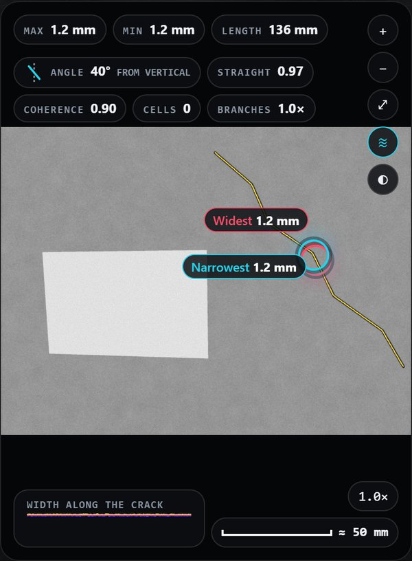
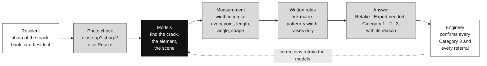

# Second Look

Second Look helps people living in ageing reinforced-concrete buildings decide whether a crack needs an engineer. A resident photographs the crack with a bank card beside it. The app checks the photo, finds the crack, measures it in millimetres and reads its pattern. Written, auditable rules then give one of five answers, and an engineer confirms every serious case. It never says a building is safe: it decides who looks next, and how soon.

**The model measures, rules decide, an engineer confirms.**

IAAC Barcelona · MaAI · Research Studio "Operable Futures" · 2026–27 · Jerome Eid (@jeromgeid-ui), Luis Sebastian Wulf (@wulfluis) · Stage 4, Operation and End-of-Life

| The phone page | The crack to explore |
|---|---|
|  |  |

Screenshots of the app on a synthetic test photo made by `src/measure/synthetic.py`: no real home and no resident's photo.

## The problem

Residents of old buildings see cracks every day but cannot tell a harmless one from a sign of structural failure, and engineers are too few to inspect every building.
Tripoli, February 2026: two blocks collapsed on 8 February (14 to 15 dead, per AFP and Reuters), and 114 buildings were ordered evacuated.
Rana Plaza, Dhaka, 2013: cracks were visible the day before the collapse.

An engineer cannot visit every crack. Second Look sorts them, so the engineer goes first where it matters, and every doubtful case still reaches a person.

## What it does

White: people. Grey: written rules and plain measurement. Black: learned models.

- **Two photos.** Photo 1 is the crack close up with a bank card (85.60 × 53.98 mm) as the scale. Photo 2 is the whole beam, column or wall. The card links the two, so the app knows where the crack sits on the element.
- **Models only perceive.** A U-Net finds the crack pixels; other models say whether the photo is a close-up and which element it shows. Any model that is unsure sends the case to "Expert needed".
- **Plain measurement.** The width is measured across the crack at every point, with its uncertainty; the widest point decides the level.
- **Written rules decide.** The risk matrix crosses the crack pattern with the width. The element, the place on it and warning signs can only raise the level, never lower it.
- **Five answers only.** Retake, Expert needed, Category 1 (monitor), Category 2 (low-cost advice and a recheck), Category 3 (an engineer must confirm). Every answer carries a one-sentence reason. There is no "safe".
- **Rechecks.** The same crack is photographed again; growth beyond the measurement's uncertainty raises its level.

### The risk matrix

Every value is illustrative until calibrated with our engineering partners. The numbers live in `src/triage/risk_matrix_v3.json`; `src/triage/matrix.py` only applies them.

### The live wall

Shared results appear on a wall for the class projector, one tab per answer. A result opens over the wall: the crack to explore on the left, the level and its reason on the right, and the crack's 3D model from Rhino and Grasshopper below.

"Expert needed" here because photo 2 was not sent: without the element the pattern cannot be read, and doubt goes to a person.

## Where AI is used

Learned models only perceive. Every level comes from written rules in `src/triage/`, so the same photo always gives the same answer and every answer names its rule.

| Job | Done by | Compared with | Result so far |
|---|---|---|---|
| Find the crack's pixels | U-Net, ResNet-34 encoder (crack model v4) | Our previous model, v3 | Building concrete, 588 unseen tiles: 261 of 281 cracks found, 5 false alarms on 307 tiles without a crack (v3: 30 missed, 21 false alarms) |
| Is the photo a close-up? | ConvNeXt-tiny on PHI-Net's scene classes | No check | No whole building let through; 4 % of close-ups sent to retake; 588 of 588 concrete crack close-ups pass |
| Which element is it? | ConvNeXt-tiny on PHI-Net | Our first element model | Answers 67 % of 579 test photos with confidence, right on 86 % of those; a column called something else 4.9 % of the time (first model: 20.5 %) |
| Spalling or an exposed bar | ConvNeXt-tiny on PHI-Net | | 89.7 % of spalling caught, 19.2 % false alarms on test photos |
| Width in mm | Plain measurement from the bank card, no AI | A printed gauge with known widths | Gauge and script ready (D50); no photos taken yet, so no result |
| The level | Written risk matrix, no AI | An engineer's visual check | Not run yet: it needs engineer-labelled photos of our own |

These are scores on public photos, not on our own, and not yet against the non-AI baseline. Success means beating an engineer's visual check on held-out, engineer-labelled photos while missing almost no Category 3 cases. We stop or redesign if the tool misses Category 3 cases that engineers would flag.

**Known failure:** the crack model only knows close-ups. On 30 photos of whole damaged buildings it said "Crack found" 28 times, reading window frames, wires and edges as cracks. The scene check now stops most such photos, and a written rule ignores a long straight line such as a wall's edge (D51). That rule can also drop a real, very straight crack: still open.

Full crack-model results

**Crack model v4, on photos it never saw in training** (`docs/experiments/2026-10-29_unet_first_training.md`, D48):
- Real building concrete (588 tiles, Özgenel [49]): 261 of 281 cracks found (17 missed, 3 sent to an expert), 5 false alarms on 307 tiles without a crack, pixel F1 0.85. v3 missed 30 and raised 21 false alarms there.
- Public close-ups, mostly pavement (906 photos): 530 of 550 cracks found (18 missed, 2 sent to an expert), 6 false alarms on 356 photos without a crack (none on brick), pixel F1 0.64. v3 missed 12 there: this is v4's known weakness.

More in `docs/experiments/` and `spec/features/evaluation.md`.

## Data

The concept is cracks in buildings in slum-like, informal neighbourhoods. See `docs/data_map.md`: every source is ranked by how close it is to that case.
- Closest public data: engineer surveys of damaged buildings after the Haiti 2010 and Nepal 2015 earthquakes, rated light / moderate / severe (one rating per building, no scale).
- Building and masonry crack images: METU, Darbhanga, Strathclyde (crack / no crack, no scale).
- Generic crack pixels for pre-training: CrackSeg9k, crack-seg. Bridge and pavement sets are off-concept.
- Still to collect: our own phone photos with a bank card next to the crack, rated by our engineering partners (Engineers Without Borders and a third-party structural engineer).

**Can we train with it?** Partly. There is enough public data to train the step that finds cracks (segmentation and detection). There is not enough to train or prove the step that rates danger: no public dataset has our seven crack patterns, a scale for width in mm, or an engineer's rating per crack. Those come only from our own photos and the engineering partners (`docs/data_map.md`, section 0b).

Raw data is not committed; `data/` stays empty in the repository.

## Where we are (21 Nov 2026)

- **Working in the app:** photo check, crack model, bank-card measurement, element and scene models, the two linked photos, the risk matrix, the crack viewer, the live wall, and each crack in 3D in Rhino and Grasshopper.
- **Building data over MCP:** a small server gives a building's floors, year, type and material from OpenStreetMap, as suggestions that never lower a level (`src/mcp_osm/`).
- **Not trained yet:** the material model (concrete or not), a slab class and a crack-pattern model. Today written rules suggest the pattern from the crack's angle and shape.
- **Not calibrated yet:** every threshold in the risk matrix, and the width against known widths.
- **Next:** questions to the author of our reference thesis, width-check photos, a real 3D scan of a crack, and engineer-labelled photos for the baseline comparison.
- The full history of what was built and when: `docs/status_history.md` and `spec/decisions.md`. This week's tasks: `docs/weekly_todo.md`. The plan to the final presentation on 17 Dec: `spec/constitution/roadmap.md`.

## Limitations

A surface photo cannot show rebar, concrete strength or foundations, and it cannot see how deep a crack goes. Concrete and brick crack differently and need separate data. Public crack data is mostly concrete and pavement.

## Run it

Tests:

    pip install -r requirements.txt
    pytest

The app:

1. Python 3.10 or newer. With an NVIDIA GPU, install torch first with the CUDA build named in `requirements.txt`; without one the app runs on the CPU, slower (a few seconds per photo).
2. `pip install -r requirements.txt`
3. Download the model file [unet_crack.pt](https://github.com/iaac-maai/operable_futures_research_studio_2026_Team_Jerome_Luis/releases/download/model-v4/unet_crack.pt) (v4, about 98 MB, release `model-v4`) and put it in `models/`. Also download [element_convnext_tiny_phinet6_v2.pt](https://github.com/iaac-maai/operable_futures_research_studio_2026_Team_Jerome_Luis/releases/download/models-element-scene-v1/element_convnext_tiny_phinet6_v2.pt) and [scene_convnext_tiny_phinet1.pt](https://github.com/iaac-maai/operable_futures_research_studio_2026_Team_Jerome_Luis/releases/download/models-element-scene-v1/scene_convnext_tiny_phinet1.pt) (release `models-element-scene-v1`, about 106 MB each, PHI-Net licence: non-commercial) into `models/`; without them the app runs without the element and scene checks (`models/README.md`).
4. On this laptop only: `py -m streamlit run src/app/second_look.py`, then open `http://localhost:8501` (phone page) and `http://localhost:8501/?wall` (live wall).
5. With a public link for phones (class demo): `py src/app/launch.py`. It opens the team's fixed link https://cranium-bladder-tapioca.ngrok-free.dev through ngrok (install it, then `ngrok config add-authtoken <your token>` once; never commit the token), so the QR is always the same (`docs/presentation/midterm/assets/qr_fixed.png`). Only one laptop can serve that link at a time. Without ngrok it falls back to a random Cloudflare link (`winget install --id Cloudflare.cloudflared`). It prints the phone link, the wall link for a teammate and the QR page (`http://localhost:8501/?qr`). The link only answers while the app runs; the free ngrok plan shows a one-time "You are about to visit" page first.
6. To measure a crack: lay a bank card (or any card that size) flat on the wall next to the crack, all four corners visible, number covered; hold the phone parallel to the wall. The phone page then shows the width, length and camera tilt; each photo on the live wall opens its own page with the numbers. After a code update, stop the launcher (Ctrl+C) and start it again: a running app keeps the old code in memory.

Photos are analysed in memory and never saved; the wall forgets them when the app stops.

## How the repository is organised

| Folder | What is in it |
|---|---|
| `src/quality/` | the photo check and the scene check |
| `src/segmentation/` | the crack model: prepare, train, predict, decide, evaluate |
| `src/measure/` | bank-card detection, camera tilt, crack width and length in mm, the width gauge |
| `src/element/` | the element and spalling models, and what photo 2 adds |
| `src/triage/` | the risk matrix, the pattern rules, the dispatch rule and the evaluation tables |
| `src/app/` | the app: phone page, live wall, crack viewer, theme, launcher, logo |
| `src/gh3d/` | each crack in 3D: the model in plain Python and the Grasshopper script for Rhino 8 |
| `src/mcp_osm/` | the MCP server for building data from OpenStreetMap |
| `tests/` | the tests: run `pytest` |
| `spec/` | the constitution (mission, roadmap, tech stack), one spec per feature, the decisions log |
| `docs/` | data map, sources, experiments, literature notes, weekly to-do, README images |
| `figures/` | the diagrams |
| `models/`, `data/` | model files and local data, never committed (the models are on GitHub Releases) |

`AGENTS.md` is the system constitution: how anyone, a person or a coding agent, works in this repository.

## A few rules

- It never issues a permit, a clearance or a "safe". Any doubt goes to an expert.
- Photos belong to the household: used only with consent, faces and addresses removed, never committed.
- Every number has a source in `docs/sources.md`, or it is marked "assumption" or "illustrative until calibrated".

## AI usage disclosure

This repository was set up with help from Claude (Anthropic). Review everything before relying on it.

## License

Code under the MIT License (see `LICENSE`). Datasets follow their own terms.
