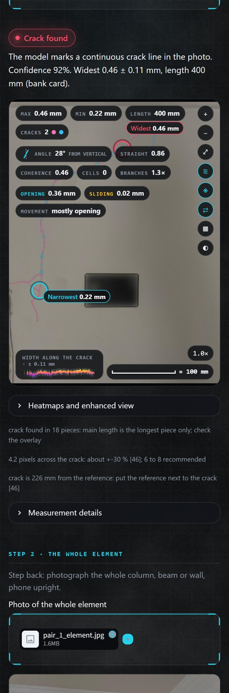
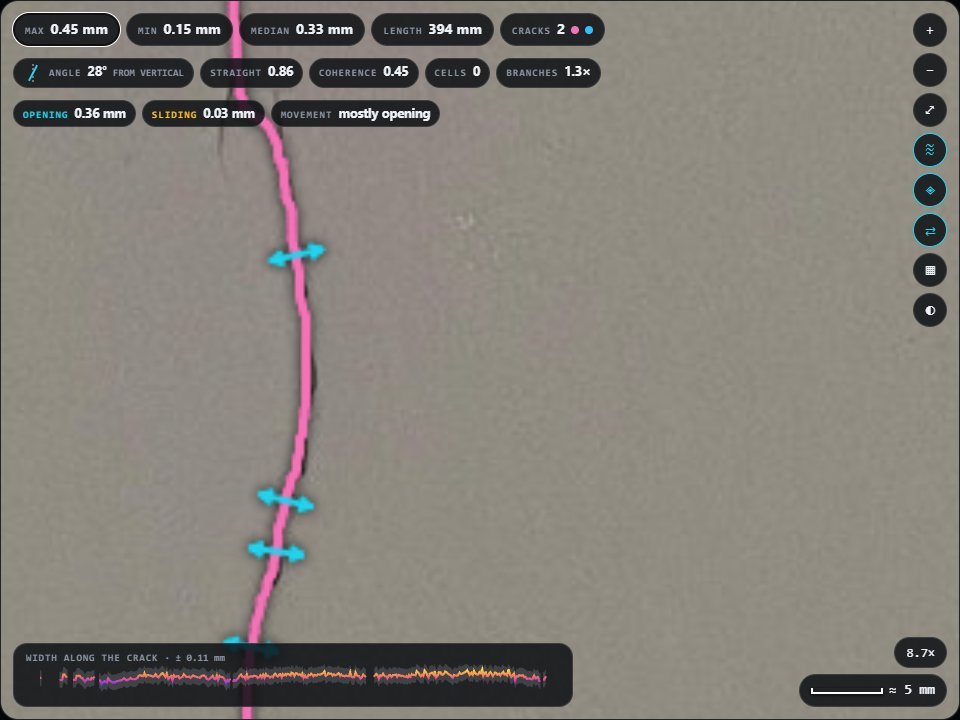
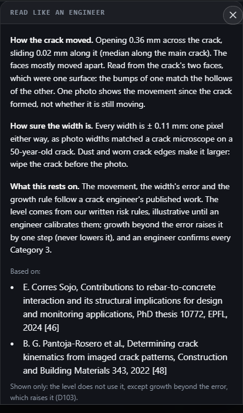
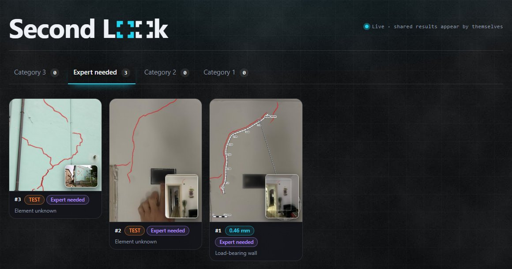
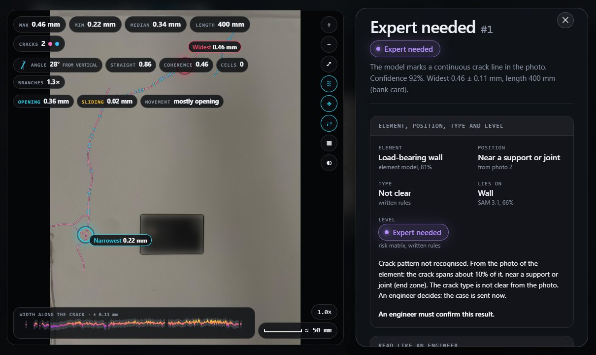
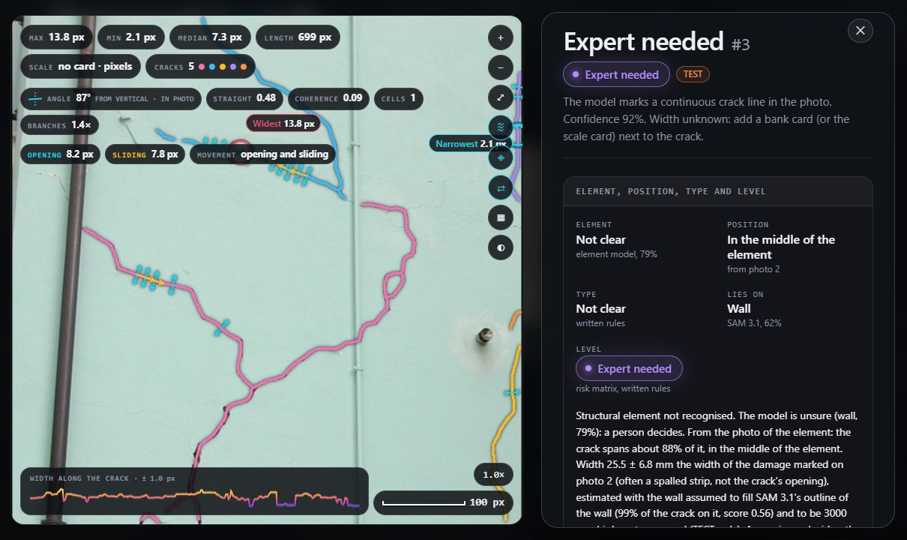
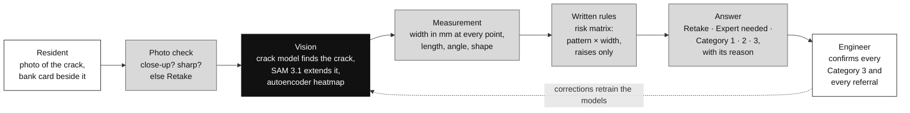

Crack triage for ageing concrete homes, from two phone photos 
Jerome Eid, Luis Sebastian Wulf 
IAAC MaAI · Research Studio "Operable Futures" · 2026/27 · Stage 4, Operation and End-of-Life

Residents of old concrete buildings see cracks every day but cannot tell a harmless one from a warning sign, and engineers are too few to look at them all. Second Look sorts them. A resident photographs the crack with a bank card beside it and the whole beam, column or wall. The app traces every crack, measures its width in millimetres at every point, reads its pattern, and written rules give one of five answers, each with its reason. An engineer confirms every serious case. It never says a building is safe: it decides who looks next, and how soon.

<b>The model measures, rules decide, an engineer confirms.</b>

The crack viewer on the team's own field photo, with a bank card beside the crack (the card blurred). Every number in it is the app's own reading. No resident's photo appears in this repository.

## The problem

Residents of old buildings see cracks every day but cannot tell a harmless one from a sign of structural failure, and engineers are too few to inspect every building.
Tripoli, February 2026: two blocks collapsed on 8 February (14 to 15 dead, per AFP and Reuters), and 114 buildings were ordered evacuated.
Rana Plaza, Dhaka, 2013: cracks were visible the day before the collapse.

## The app

A resident opens the phone page, ticks "I put a bank card next to the crack", and sends the photo. The answer comes back with the crack to explore: zoom, drag, click the widest or narrowest point for a loupe with the width there, and the crack's numbers in the picture. Then the app asks for a photo of the whole element, finds the crack on it, and gives the level.

| The phone page | The crack to explore |
|---|---|
|  |  |

What the viewer shows:

- **Every crack, each in its own colour.** Independent cracks get their own colour; a crack the model found in pieces with small gaps stays one crack. The widest point over all of them decides the level.
- **The width at every point.** In millimetres with the bank card, in pixels without it, never invented.
- **The crack's shape.** Its angle, how straight it runs, its branches and the closed cells of a network, which the written rules read to suggest its type.
- **What looks different from sound concrete.** The autoencoder's heatmap, as a separate layer.
- **How the crack moved, as a crack engineer reads it.** Cyan arrows across the crack show its opening, amber arrows along it its sliding, read from the crack's two faces: they were one surface, so the bumps of one match the hollows of the other. This is the method of Pantoja-Rosero et al. (EPFL, 2022) used in E. Corres Sojo's PhD thesis on cracks in reinforced concrete (EPFL, 2024), written as our own code and checked on the authors' published test cracks.
- **How sure each width is.** A grey band of ± 1 pixel on the width chart: on a 50-year-old crack, photo widths matched a crack microscope within one pixel (Corres Sojo, ch. 5.2).

### How the crack moved

| Up close: opening and sliding | Read like an engineer |
|---|---|
|  |  |

Each result has a panel, **Read like an engineer**: how the crack moved, how sure the width is, what a crack along a steel bar means for the bar's grip, whether it has grown since an earlier photo, and the sources it rests on. A crack measured twice with a bank card that has grown by more than the two photos' errors raises the level by one step (E. Corres Sojo's rule: only growth beyond the error counts); nothing in the panel ever lowers a level.

### On real elements

The second photo shows the whole element. The app carries the crack across, traces every crack inside the element's outline, and SAM 3.1 names the parts. Here on a building cracked by an earthquake, from the EPFL test photos [Pantoja-Rosero et al. 2022](https://doi.org/10.1016/j.conbuildmat.2022.128264) (CC BY 4.0):

Of five such photos, only this one passed the close-up check: the other four close-ups, cut from far photos, were sent back as "Retake". That check is still too strict on cut close-ups (`docs/weekly_todo.md`).

With a bank card, the crack is measured in millimetres and drawn in 3D on its element in Rhino and Grasshopper, with how it moved (`src/gh3d/`).

Shared results appear on a live wall for the class projector, one tab per answer. A result opens over the wall: the crack on the left, the level and its reason on the right, and the crack in 3D from Rhino and Grasshopper.

| A result opened over the wall: the field crack, in mm | The EPFL wall, in pixels (no card) |
|---|---|
|  |  |

Real photos only: the team's own field cracks and a building cracked by an earthquake from the EPFL test photos (CC BY 4.0). All three answer "Expert needed", each for its reason: a crack pattern the written rules do not recognise, an element the model is not sure of. The app does not guess.

## How it works

White: people. Grey: written rules and plain measurement. Black: learned models.

- **Two photos.** Photo 1 is the crack close up with a bank card (85.60 × 53.98 mm) as the scale; photo 2 is the whole element. The card links them, so the app knows where the crack sits on the element.
- **Models only see.** The crack model finds the crack and decides whether there is one; SAM 3.1 extends it along faint branches; other models say whether the photo is a close-up and which element it shows. Any model that is unsure sends the case to "Expert needed".
- **Rules decide.** The risk matrix crosses the crack pattern with the width; the element, the place on it and warning signs can only raise the level. Every value is illustrative until our engineering partners calibrate it (`src/triage/risk_matrix_v3.json`).
- **Five answers only.** Retake, Expert needed, Category 1 (monitor), Category 2 (low-cost advice and a recheck), Category 3 (an engineer must confirm). There is no "safe".

## Where AI is used

Learned models only see. Every level comes from written rules in `src/triage/`, so the same photos always give the same answer and every answer names its rule. Each model is measured against the plain way of doing its job, and the table says where it loses.

| Job | Done by | Compared with | Result so far |
|---|---|---|---|
| Find the crack | U-Net, ResNet-34 encoder (crack model v5, trained also on the EPFL photos of cracked buildings after earthquakes), two thresholds | Our previous model v4, and the EPFL group's own model | Our 76 real cases: 3 cracks missed (v4: 9; EPFL model: 2, but 2.5 times the false alarms). Building concrete, 588 unseen tiles: 20 of 281 missed, 8 false alarms on 307 clean tiles (v4: 19 and 5) |
| Trace the whole crack | SAM 3.1 adds the lines connected to the crack found | The crack model alone | Same 588 tiles: 84.4 % of the crack traced instead of 81.6 %, the same 19 missed and 5 false alarms. Alone, SAM would have drawn cracks on 35 of the 307 clean tiles, so it never decides |
| Is the photo a close-up? | ConvNeXt-tiny on PHI-Net's scene classes | No check | No whole building let through; 4 % of close-ups sent to retake |
| Which element is it? | ConvNeXt-tiny on PHI-Net | Our first element model | Answers 67 % of 579 test photos with confidence, right on 86 % of those; a column called something else 4.9 % of the time (first model: 20.5 %) |
| What looks different from sound concrete | Autoencoder trained on 39,885 sound-concrete photos | No check | Lights up the crack on 256 of 281 tiles, a false area on 0 of 307 clean tiles. It does not see soft stains (rust, damp): shown only, never a level |
| Spalling as an area | SAM 3.1 with four prompts | Photos with and without spalling | Not reliable: the best prompt lit 52 % of spalling photos and 22 % of clean ones. Not shown |
| Width in mm | Plain measurement from the bank card, no AI | A printed gauge with known widths | Gauge and script ready; no photos taken yet |
| How the crack moved | Plain measurement: the two faces matched, no AI (method of [Pantoja-Rosero et al. 2022](https://doi.org/10.1016/j.conbuildmat.2022.128054)) | The known movements of the authors' 56 published test cracks | Sliding within 0.85 px; opening 1.4 px too large (their masks include border pixels); "mostly opening" or not right on 50 of 53. Shown only |
| The level | Written risk matrix, no AI | An engineer's visual check | Not run yet: it needs engineer-labelled photos of our own |

These are scores on public photos, not on our own. Success means beating an engineer's visual check on held-out, engineer-labelled photos while missing almost no Category 3 cases; we stop or redesign if the tool misses Category 3 cases that engineers would flag. Details: `docs/experiments/`.

## Where we are (22 Nov 2026)

- **Working:** photo check, crack model with SAM 3.1 tracing, bank-card measurement, every crack in its own colour, element and scene models, the two linked photos with every crack traced on the whole element, the risk matrix, the crack viewer with each crack's opening and sliding, the autoencoder heatmap, growth since an earlier photo, the live wall and each crack in 3D in Rhino and Grasshopper.
- **New today:** crack model v5, trained also on the EPFL photos of cracked buildings after earthquakes: 3 real cracks missed instead of 9. A crack that has grown beyond the measurement's error raises the level.
- **Not yet:** spalling, rust and damp as areas (they need close-up photos of real defects to test on); a material model; every threshold is still to be calibrated with our engineering partners.
- **Next:** photos of real spalling, rust and damp with the card, width-check photos, engineer-labelled photos for the baseline comparison, the app online.
- The full history: `docs/status_history.md` and `spec/decisions.md`. This week: `docs/weekly_todo.md`. The plan to the final presentation on 17 Dec: `spec/constitution/roadmap.md`.

## Run it

Tests:

    pip install -r requirements.txt
    pytest

The app:

1. Python 3.10 or newer. With an NVIDIA GPU, install torch first with the CUDA build named in `requirements.txt`; without one the app runs on the CPU, slower (a few seconds per photo).
2. `pip install -r requirements.txt`
3. Download the model file [unet_crack.pt](https://github.com/iaac-maai/operable_futures_research_studio_2026_Team_Jerome_Luis/releases/download/model-v5/unet_crack.pt) (v5, about 98 MB, release `model-v5`; v4 stays in release `model-v4`) and put it in `models/`. Also download [element_convnext_tiny_phinet6_v2.pt](https://github.com/iaac-maai/operable_futures_research_studio_2026_Team_Jerome_Luis/releases/download/models-element-scene-v1/element_convnext_tiny_phinet6_v2.pt) and [scene_convnext_tiny_phinet1.pt](https://github.com/iaac-maai/operable_futures_research_studio_2026_Team_Jerome_Luis/releases/download/models-element-scene-v1/scene_convnext_tiny_phinet1.pt) (release `models-element-scene-v1`, about 106 MB each, PHI-Net licence: non-commercial) into `models/`; without them the app runs without the element and scene checks (`models/README.md`).
4. On this laptop only: `py -m streamlit run src/app/second_look.py`, then open `http://localhost:8501` (phone page) and `http://localhost:8501/?wall` (live wall).
5. With a public link for phones (class demo): `py src/app/launch.py`. It opens the team's fixed link https://cranium-bladder-tapioca.ngrok-free.dev through ngrok (install it, then `ngrok config add-authtoken <your token>` once; never commit the token), so the QR is always the same (`docs/presentation/midterm/assets/qr_fixed.png`). Only one laptop can serve that link at a time. Without ngrok it falls back to a random Cloudflare link (`winget install --id Cloudflare.cloudflared`). It prints the phone link, the wall link for a teammate and the QR page (`http://localhost:8501/?qr`). The link only answers while the app runs; the free ngrok plan shows a one-time "You are about to visit" page first.
6. To measure a crack: lay a bank card (or any card that size) flat on the wall next to the crack, all four corners visible, number covered; hold the phone parallel to the wall. The phone page then shows the width, length and camera tilt; each photo on the live wall opens its own page with the numbers. After a code update, stop the launcher (Ctrl+C) and start it again: a running app keeps the old code in memory.

Photos are analysed in memory and never saved; the wall forgets them when the app stops.

## Repository

| Folder | What is in it |
|---|---|
| [`src/quality/`](src/quality/) | the photo check and the scene check |
| [`src/segmentation/`](src/segmentation/) | the crack model (prepare, train, predict, decide, evaluate) and SAM 3.1's extension |
| [`src/measure/`](src/measure/) | bank-card detection, camera tilt, every crack's width and length in mm |
| [`src/anomaly/`](src/anomaly/) | the autoencoder trained on sound concrete, its heatmap and the area rules |
| [`src/element/`](src/element/) | the element and spalling models, SAM 3.1's parts, what photo 2 adds |
| [`src/triage/`](src/triage/) | the risk matrix, the pattern rules, the dispatch rule and the evaluation tables |
| [`src/app/`](src/app/) | the app: phone page, live wall, crack viewer, theme, launcher, simulated residents |
| [`src/gh3d/`](src/gh3d/) | each crack in 3D: the model in plain Python and the Grasshopper script for Rhino 8 |
| [`src/mcp_osm/`](src/mcp_osm/) | the MCP server for building data from OpenStreetMap |
| [`tests/`](tests/) | the tests: run `pytest` |
| [`spec/`](spec/) | the constitution (mission, roadmap, tech stack), one spec per feature, the decisions log |
| [`docs/`](docs/) | data map, sources, experiments, literature notes, weekly to-do, the images of this README |
| `models/`, `data/` | model files and local data, never committed (the models are on GitHub Releases) |

`AGENTS.md` is the system constitution: how anyone, a person or a coding agent, works in this repository.

## Data

The concept is cracks in buildings in slum-like, informal neighbourhoods. See `docs/data_map.md`: every source is ranked by how close it is to that case.
- Closest public data: engineer surveys of damaged buildings after the Haiti 2010 and Nepal 2015 earthquakes, rated light / moderate / severe (one rating per building, no scale).
- Building and masonry crack images: METU, Darbhanga, Strathclyde (crack / no crack, no scale).
- Generic crack pixels for pre-training: CrackSeg9k, crack-seg. Bridge and pavement sets are off-concept.
- From the EPFL group of E. Corres Sojo, our reference crack engineer: photos of plastered and masonry buildings cracked by earthquakes, with crack masks (TOPO-Loss, CC BY 4.0), lab walls with crack masks (DIC, CC BY 4.0), and test cracks with known movements (crack kinematics, CC BY 4.0). Crack model v5 learned from the first two.
- Our own: the team's field photos with a bank card (in the README, one with the card blurred, with the team member's consent).
- Still to collect: our own phone photos with a bank card next to the crack, rated by our engineering partners (Engineers Without Borders and a third-party structural engineer).

**Can we train with it?** Partly. There is enough public data to train the step that finds cracks (segmentation and detection). There is not enough to train or prove the step that rates danger: no public dataset has our seven crack patterns, a scale for width in mm, or an engineer's rating per crack. Those come only from our own photos and the engineering partners (`docs/data_map.md`, section 0b).

Raw data is not committed; `data/` stays empty in the repository.

## AI usage

| | |
|---|---|
| Tools | Claude Code (agent) |
| Why | to move fast on models, measurement and an app that were new to us, and for first drafts of the specs and texts |
| Where | the training and evaluation scripts, the measurement code, the risk matrix code from our written rules, the app and the crack viewer, the autoencoder, SAM 3.1's extension, the Grasshopper script, the figures and the images of this README, and first drafts of the specs and the decisions log |
| How | every feature starts as a spec in `spec/`, then code, then tests (629 pass); every model is scored on photos it never saw and against the plain way; thresholds are chosen on validation photos and reported on test photos; the levels come only from written rules; the team reads every decision in `spec/decisions.md` |

Lessons learned:
- **A number that looks good can hide a blind model.** The autoencoder's first threshold flagged almost nothing on real plaster; it was set on rough concrete. Look at the pictures, not only the score.
- **A strong model is not a judge.** SAM 3.1 traces cracks beautifully but draws them on clean walls too, so it may only extend a crack our own model found.
- **Never mix pictures that do not belong together.** A drawn close-up next to a real, unrelated element photo looks convincing and proves nothing; every case now shows one crack in both photos, or stays alone.

## Licence

Code under the MIT License (see `LICENSE`). Datasets follow their own terms (`docs/sources.md`).
