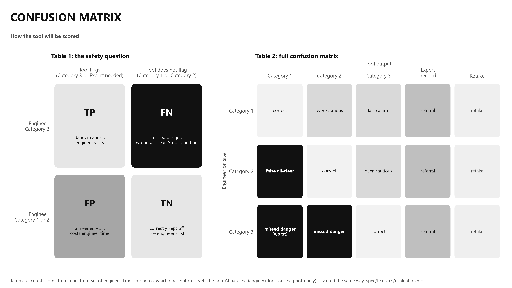

# Feature: evaluation (`src/triage/evaluate.py`)

Status: definitions and code ready; no results yet. All numbers come from a held-out test set of engineer-labelled photos, which does not exist yet.

## Ground truth and comparisons
- Ground truth: the rating (Category 1, Category 2, Category 3) of an engineer who assessed the building on site (deck slide 10: "buildings an engineer already assessed").
- Tool: the output of `triage()` on the photo.
- Non-AI baseline: an engineer's visual check of the same photo, without the tool. Scored with the same tables.

## Table 1: the safety question (binary)
Positive = the on-site engineer rated the crack Category 3. "Flagged" = the tool sent the case to a human (Category 3 or Expert needed).

|  | Tool flags (Category 3 or Expert needed) | Tool does not flag (Category 1 or Category 2) |
|---|---|---|
| **Engineer: Category 3** | **TP**: danger caught, engineer visits | **FN**: missed danger, a wrong all-clear lands on residents. Stop condition. |
| **Engineer: Category 1 or Category 2** | **FP**: unneeded engineer visit, costs scarce engineer time | **TN**: correctly kept off the engineer's list |

Retake is not counted in Table 1; it is reported as the retake rate. A Category 3 crack that stays in the retake loop is reported separately, as missed in the field.

### Metrics
| Metric | Formula | Why it matters | Target |
|---|---|---|---|
| Recall on Category 3 (sensitivity) | TP / (TP + FN) | Share of dangerous cracks caught | Near 1 (target, not a result) |
| Missed Category 3 (false negative rate) | FN / (TP + FN) | Main failure; stop or redesign if engineers would flag what we miss | Near 0 (target) |
| Referral rate | (TP + FP) / all assessed | Engineer workload | "Only a few", number to set with the engineering partner |
| Precision of flags | TP / (TP + FP) | How many visits were needed | Tracked |
| Retake rate | Retake / all photos | Does the photo protocol work on ordinary phones | Tracked |

## Table 2: full confusion matrix (3 x 5)
Rows: engineer on site. Columns: tool output. Each cell is a count; the label says what kind of error it is.

| Engineer \ Tool | Category 1 | Category 2 | Category 3 | Expert needed | Retake |
|---|---|---|---|---|---|
| **Category 1** | correct | over-cautious | false alarm | referral | retake |
| **Category 2** | **false all-clear** | correct | over-cautious | referral | retake |
| **Category 3** | **missed danger (worst)** | **missed danger** | correct | referral (safe) | retake |

"False all-clear" (tool says Category 1, engineer says Category 2 or Category 3) is counted separately: Category 1 must be earned (AGENTS.md rule 3).

## Threshold curve
Recompute Table 1 for confidence thresholds 0.5 to 0.95 and plot missed Category 3 against referral rate (deck slide 7 shows the illustrative shape). Pick the threshold with the engineering partner, then record it in `spec/decisions.md`.

## Test with people who know nothing about buildings (D118 to D121, review 26 Nov 2026)
Protocol, not yet run. 5 people with no building background (for example a parent or an aunt), each alone with a phone and the sample crack photo, no help.
Tasks: (1) take and send the photo with the card; (2) say what the app found and what to do now; (3) show only the widest crack; (4) remove a crack the app got wrong; (5) answer the questions.
Record: done or not, time, where they hesitated, what they said the result means. Fail if anyone reads the result as "safe".
